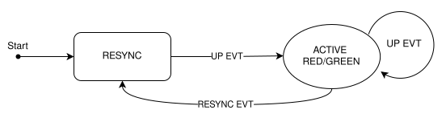

# Realizzazione di semafori smart
Come parte di un 	_compito_ da svolgere in gruppo per il corso universitario di IoT (UniCT/DMI), è stato realizzato un firmware per la gestione di un gruppo di semafori su di un incrocio stradale.

Il firmware realizzato, dopo attente analisi di design _super mega_ costruttive tra i colleghi, sfrutta la tecnologia **ESP-MESH** per la realizzazione di una rete mesh _WLAN_ tra i dispositivi **ESP32-S3** forniti, su questa tecnologia è stato sviluppato un protocollo *master/slave* per la coordinazione del gruppo di semafori.

## Protocollo realizzato
È stato scelto di fruttare le caratteristiche di **ESP-MESH** usare un _nodo radice_ per identificare le nostro protocollo l'entità del _master_, il quale coordina se stesso e gli altri _slave_ nel direzionamento del semaforo.

Ogni semaforo all'avvio infatti parte nello stato di **RESYNC**, nel quale viene gestita la logica di collegamento alla rete **ESP-MESH**, la automatica elezione del _master_ e l'attesa di comandi da parte di quest'ultimo: infatti, come esplicitato dal grafo mostrato qui sotto, una volta completata dal _master_ la fase di _riconciliazione_ con gli _slave_, questo emette uno tra gli eventi `UP_HORIZONTAL` e `UP_VERTICAL`, ognuno corrispondente alla direzione in cui un semaforo viene posto, i quali porranno gli stati dei semafori in `ACTIVE_RED` o `ACTIVE_GREEN`.

Ogni qualvolta il _master_ perde una fittizia connessione con un suo _slave_, manderà un evento di `RESYNC` a tutti gli _slave_ collegati affinché questi entrano nell'omonimo stato, tale da rendere i led di _lampeggianti in giallo_, ad indicazione di un errore logico nel sistema, come accade nella vita reale. Analogamente, quando uno _slave_ è uscito dalla rete, entrerà nel medesimo stato e anche questo sarà _lampeggiante giallo_.

Si nota che un semaforo in `ACTIVE_GREEN`, col tempo cambierà sempre colore da _verde_, in _giallo_ e infine _rosso_ cambiando stato in `ACTIVE_RED`: in questo modo, qualunque errore vi possa essere, a meno di utenti della strada indisciplinati, l'incrocio non dovrebbe essere impegnato.



### Coordinazione da parte del master
Il nodo master è responsabile di coordinare gli _slave_ e se stesso, in particolare ogni _slave_ collegato alla rete, manda un messaggio di `PING` al _master_, di questo messaggio salverà il tempo di ricezione _timestamp_.

Qualora il _master_ vi trovi in stato di `RESYNC`, controllerà continuamente che tutti i _timestamp_ dei nodi collegati siano sufficientemente recenti, qualora il controllo passi, imposterà il suo stato in `ACTIVE_RED`, uscendo dal ciclo di `RESYNC`

Quando il _master_ esce dal loop di conciliazione, orchestra se stesso e gli altri _slave_ mandando ad ognuno un messaggio alternando tra `UP_VERTICAL` e `UP_HORIZONTAL` per ogni ciclo, interpretando per se il comando in quando anche il _master_ è un semaforo. Gli slave, una volta che abbiano ricevuto uno dei comandi di `UP`, anch'essi seguiranno a passare ad uno stato diverso da quello di conciliazione.

Si nota che, al fine di facilitare lo sviluppo, qualora si aggiungessero dispositivi alla rete mesh, quindi volendo aggiungere un semaforo, il master automaticamente accetterà il nuovo dispositivo, diversamente nel caso di perdita che lo porterà allo stato di `RESYNC` ed emetterà perioditicamente l'omonimo messaggio `RESYNC` per mettere in stato di errore gli _slave_.

### Comandi
La **direzione del semaforo** fa parte dello stato del semaforo stesso, ed è possibile cambiarla, alternando tra orizzontale e verticale, usando il pulsante `BTN2`.

Infine il **master** che tiene traccia del numero di dispositivi collegati, può resettare tale aspettativa tramite pressione del pulsante `BTN1`, il quale porterà il _master_ ad auto regolarsi sul numero di semafori collegati.

## Configurazione
Si invita a creare il file `secrets.h` dentro la cartella `include`, dove inserire le credenziali del , per esempio:

```c
#define SSID nomeficowifi
#define PASSWORD	fabriziotriamo
```

### Autori
Siamo i più forti:
- [Vulcalien](https://github.com/Vulcalien)
- [fabrizio-07](https://github.com/fabrizio-07)
- [marcospampi](https://github.com/marcospampi)